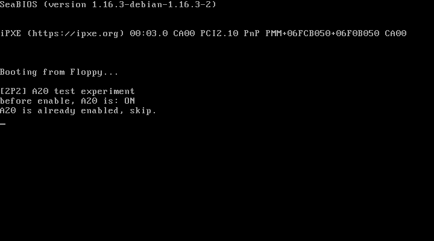

# 2P2 内存管理：A20 地址线的开启与验证

对应书中 **2.2 内存管理** 一节（2.2.1 A20地址线 / 2.2.2 全局描述符 / 2.2.3 页表原理）。

## 实验目的

1. 理解 8086 时代的地址回卷问题：实模式物理地址 = 段值 × 16 + 偏移，最大只能表达 1MB，
   超过 1MB 的地址会回卷（mod 1MB）到低端
2. 掌握通过键盘控制器 8042（端口 0x64/0x60）开启 A20 地址线的方法，
   这正是官方仓 `setup.S` 进入保护模式前所做的工作
3. 建立对 GDT/页表的直观印象（本实验只做 A20，GDT 在 2P4 中真正使用，页表在 3P1 中开启）

## 检测 A20 的原理

地址 `0x0000:0x0500` 的物理地址是 0x00500，地址 `0xFFFF:0x0510` 的物理地址是 0x100510（超过 1MB）：

- A20 **关闭**：第 21 根地址线恒为 0，0x100510 回卷到 0x000500，两个地址指向同一内存，
  往低地址写 0x55/0xAA，高地址读到的就是刚写入的值
- A20 **开启**：两个地址是不同的内存，高地址读到的值与写入值无关

## 运行效果



屏幕输出（qemu 中 BIOS 默认已开启 A20）：

```
[2P2] A20 test experiment
before enable, A20 is: ON
A20 is already enabled, skip.
```

## 运行步骤

先执行 `make`，再执行 `sh run.sh`（需要 qemu-system-i386）。

```bash
make
sh run.sh
```

## 与官方仓代码的对应关系

| 本实验 | 官方仓 linux_kernel_012 |
| ------ | ----------------------- |
| `bootsect.S` 中 `enable_a20` | `setup.S` 第 112~118 行附近：D1 命令 + DF 数据开启 A20 |
| `bootsect.S` 中 `empty_8042` | `setup.S` 第 156~161 行：等待 8042 输入缓冲区空 |
| `bootsect.S` 中 `test_a20` | 书中讲解 A20 回卷原理的配套实验（官方仓无此代码，为独立编写） |

## 常见问题

1. **qemu 里看不到 OFF→ON 的过程？** qemu 默认 A20 就是开启的，所以直接显示 ON。
   想看完整过程可以：把 `enable_a20` 改为写 0xDD（关闭 A20 的命令字节）后再检测；
   或使用 bochs 运行（bochs 中 A20 初始状态可配置）
2. **为什么要开 A20？** 只有打开第 21 根地址线，CPU 才能访问 1MB 以上的内存；
   保护模式下 32 位地址线必须先解决这个历史遗留问题。这也是进入保护模式三部曲
   （开 A20 → 建 GDT → 置 CR0.PE）的第一步
3. **0xDF 的各个位是什么意思？** 0xDF = 1101_1111：bit0 是 CPU 复位线（低有效，必须保持 1），
   bit1 是 A20 闸门（1 = 打开），bit5 在部分机型上是 A20 的另一个开关
