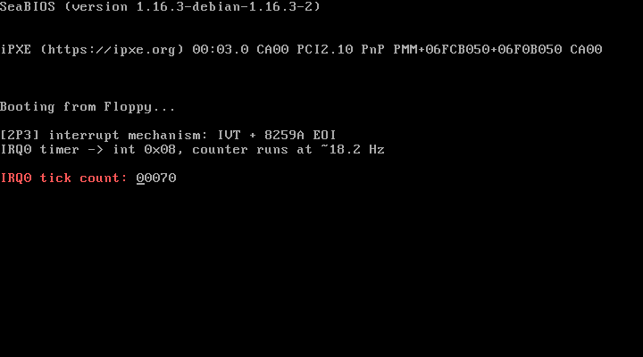

# 2P3 中断机制：实模式 IVT + 8259A 的 EOI

对应书中 **2.3 中断机制** 一节（2.3.1 中断描述符表 IDT / 2.3.2 8259A 中断控制芯片 / 2.3.3 特权级）。

## 实验目的

1. 理解中断的处理流程：硬件 IRQ → 8259A → CPU 查中断向量表 → 进入处理程序 → 发 EOI → iret
2. 实模式下的中断向量表 IVT 与保护模式下的 IDT 的关系：
   - IVT：内存 0x0000 开始的 1KB，每项 4 字节（偏移:段值），共 256 项
   - IDT：每项 8 字节的门描述符（选择子:偏移+类型+DPL），2P4 中真正使用
3. 掌握 8259A 的编程接口：本实验用到 IMR（屏蔽寄存器，端口 0x21）和 EOI 命令（端口 0x20）

## 实验内容

实模式下 8259A 默认把 IRQ0~IRQ7 映射到中断号 0x08~0x0F（与 CPU 异常向量冲突，
正式内核会在 setup 阶段重映射到 0x20 起，见 2P4）。本实验：

1. 改写 IVT 第 0x08 号表项，替换成自己的时钟中断处理程序
2. 读改写 0x21 端口，确保 IRQ0 没有被屏蔽
3. `sti` 开中断，主循环 `hlt` 休眠等待
4. 处理程序中：计数 +1 → 十进制写到 VGA 显存 → 向 8259A 主片发非指定 EOI（0x20）

## 运行效果



屏幕输出（计数器约 18.2 次/秒增长）：

```
[2P3] interrupt mechanism: IVT + 8259A EOI
IRQ0 timer -> int 0x08, counter runs at ~18.2 Hz
IRQ0 tick count: 00089
```

## 运行步骤

```bash
make
sh run.sh
```

## 与官方仓代码的对应关系

| 本实验 | 官方仓 linux_kernel_012 |
| ------ | ----------------------- |
| 处理程序中发 EOI（outb 0x20 → 0x20） | 与内核各设备驱动中断处理完成后发 EOI 的做法一致 |
| 改写 IMR（0x21 端口） | `setup.S` 初始化 8259A 后向 0x21/0xA1 写屏蔽字 |
| 中断处理程序保存/恢复现场 | `head.S` 的 ignore_int、`mm/page.S` 的 page_fault 同样的套路 |

## 常见问题

1. **为什么处理程序里用直写显存而不是 BIOS int 0x10？** 中断处理程序应尽量短，
   且正式内核进入保护模式后不能再用 BIOS 中断，直写 0xB8000 显存是内核的标准做法
2. **不发 EOI 会怎样？** 8259A 会认为中断仍在服务中，不再提交后续中断，计数器只会走一步。
   可以注释掉 EOI 两行观察现象
3. **为什么是 18.2Hz？** 8253/8254 定时器默认初值 65536，输入时钟 1193180Hz，
   1193180/65536 ≈ 18.2。内核初始化时会重设定时器频率（见后续章节）
4. **特权级在哪体现？** 实模式下没有特权级检查。保护模式下，通过 int 指令主动进入
   中断门/陷阱门时 CPU 会校验 DPL，硬件中断则不受 DPL 限制——这是 2P4 及后续实验的内容
