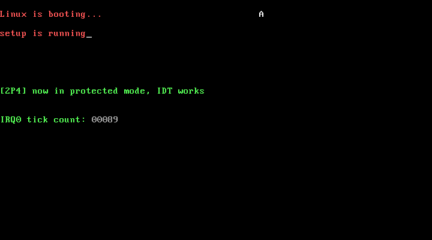

# 2P4 时钟中断：全书第一个完整的保护模式实验

对应书中 **2.4 时钟中断** 一节（2.4.1 初始化中断控制芯片 / 2.4.2 设置IDT / 2.4.3 重设GDT / 2.4.4 时钟中断实验）。

## 实验目的

把第 2 章的知识串成完整链路，从上电到保护模式下的第一个硬件中断：

```
BIOS → bootsect → setup ──→ 进入保护模式 → clock(32位) → IDT → 时钟中断
        加载 setup     采集硬件信息            │
        加载 system    system 搬到 0x0         ├ 重装段寄存器
                       开 A20 闸门             ├ 设置 IDT（256 项）
                       加载 GDT               ├ 打开 IRQ0
                       重映射 8259A(0x20起)     ├ sti
                       CR0.PE=1               └ hlt 等中断
                       远跳转 0x08:0x0
```

## 三个源文件

| 文件 | 模式 | 职责 |
| ---- | ---- | ---- |
| `bootsect.S` | 16 位 | 加载 setup(0x90200) 和 system(0x10000)，与 2P1 相同（SYSSIZE 改小为 0x800） |
| `setup.S` | 16 位 | 与 2P1 相同：do_move 把 system 搬到 0x0、开 A20、lgdt、8259A 重映射、置 PE、远跳转 |
| `clock.S` | 32 位 | **本实验新增**：重装段寄存器、设置 IDT、时钟中断计数显示 |

## clock.S 的关键点

1. **远跳转后第一件事是重装段寄存器**：CS 已由远跳转装入 0x08，
   DS/ES/FS/SS/GS 还是实模式的残留值，必须立即重装（DS=0x10 数据段，GS=0x18 显存段）
2. **IDT 填表手法与官方仓 `kernel/head.S` 的 setup_idt 一致**：
   先把 256 项全部填成指向 `ignore_int` 的中断门（选择子 0x08，类型 0x8E），
   再把第 0x20 项（重映射后的 IRQ0）改成 `clock_int`
3. **中断门 0x8E 的含义**：P=1（有效）、DPL=0（内核级）、TYPE=0xE（386 中断门，
   进入时自动清 IF 关中断，iret 时自动恢复）
4. **栈**：SS 重装为数据段，ESP 指向 0x9B000（setup 之上、BIOS 数据区之下的空闲内存）
5. **处理程序套路**：保存现场 → 计数 → 写显存 → **向 0x20 端口发 EOI** → 恢复现场 → iret

## 运行效果



```
Linux is booting...                        A     <- bootsect 消息 + setup 在保护模式写的 'A'
setup is running                                 <- setup 消息（实模式）
[2P4] now in protected mode, IDT works           <- clock.S 横幅（保护模式）
IRQ0 tick count: 00107                           <- 计数器约 18.2 次/秒增长
```

## 运行步骤

```bash
make
sh run.sh
```

## 与官方仓代码的对应关系

| 本实验 | 官方仓 linux_kernel_012 |
| ------ | ----------------------- |
| `clock.S` 的 `setup_idt` 填表循环 | `kernel/head.S` 的 `setup_idt` |
| `clock.S` 的 `ignore_int` | `kernel/head.S` 的 `ignore_int` |
| `clock_int` 的 EOI 写法 | `kernel/sys_call.S` 的 `timer_interrupt` 雏形 |
| `bootsect.S`/`setup.S` | 与官方仓同名文件一致（2P1 已详细注释） |

## 常见问题

1. **qemu 里卡住不动、屏幕只有 BIOS 信息？** 老版本 tools/build 生成的镜像只有 2.5KB，
   qemu 会把小镜像猜成 160KB 单磁头格式，bootsect 读完第一个磁道后翻磁头失败而死循环。
   本实验的 `tools/build.c` 已把镜像补齐到标准 1.44MB，规避该问题
2. **计数器为什么是 18.2Hz？** BIOS 初始化的 8254 定时器默认值 65536，
   1193180/65536 ≈ 18.2。内核后续章节会重设为 100Hz
3. **时钟中断号为什么是 0x20 不是 0x08？** setup.S 已把主片 ICW2 设为 0x20，
   IRQ0~IRQ7 对应 0x20~0x27，避开 0x00~0x1F 的 CPU 异常向量
4. **进入保护模式后还能用 BIOS 中断吗？** 不能。所以 clock.S 直接写 0xB8000 显存，
   这也是后续所有内核代码的输出方式（直到 3P2 实现格式化打印）
