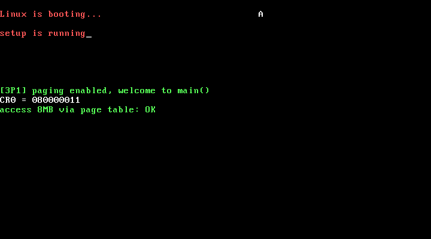

# 3P1 开启分页管理：head.S —— 内核真正的起点

对应书中 **3.1 开启分页管理**（3.1.1 设置页表 / 3.1.2 设置栈指针）。

## 实验目的

1. 理解 head.S 的内存布局技巧：代码从 0x0 开始，但真正长命的代码都在 0x5000 之后，
   运行时把 0x0~0x5000 清零回收成"页目录 + 4 个页表"
2. 掌握 i386 两级页表的填表方法：页目录项 → 页表项 → 物理页，属性位 7 = P+RW+US
3. 掌握开启分页的固定动作：`CR3 = 页目录基址` → `CR0 |= 0x80000000`（PG 位）
4. 理解 head.S 跳进 C 函数 main 的"伪造返回地址"技巧（pushl $main + ret）

## 内存布局（本实验的 head.S 用 .org 精确定位）

```
0x0000 ~ 0x0FFF  pg_dir   页目录（startup_32 的代码起初在这里，执行完即被回收）
0x1000 ~ 0x4FFF  pg0~pg3  四个页表：恒等映射线性 0~16MB → 物理 0~16MB
0x5000 ~ 0x53FF  tmp_floppy_area   软盘 DMA 缓冲（第 6 章使用）
0x5400 起          after_page_tables / setup_paging / IDT / GDT（长命代码）
~0x65C0 ~ 0x75C0  内核栈（4KB，stack_top 是栈底）
之后               main.c 编译出的 main() 等代码
```

## main.c 的验证手段

- 读 CR0 显示为 `0x80000011`：bit31(PG)=1、bit0(PE)=1，分页和保护模式同时生效
- 通过指针写读物理 8MB 处（线性 8MB 必须经 pg2 页表转换）：
  写入 0x1234abcd 后读回一致 → 页表填写正确

## 运行效果



```
Linux is booting...                        A
setup is running
[3P1] paging enabled, welcome to main()
CR0 = 080000011
access 8MB via page table: OK
```

## 运行步骤

```bash
make
sh run.sh
```

## 与官方仓代码的对应关系

| 本实验 | 官方仓 linux_kernel_012 |
| ------ | ----------------------- |
| `head.S` 全部 | `kernel/head.S`（官方把 stack_start 放在 sched.c，本实验先内联在 head.S 里，第 4 章再挪回进程相关文件） |
| `head.S` 的 A20 检查循环 | 同官方：往 0x0 写递增值比较 1MB 处 |
| `main.c` | `kernel/main.c` 的最小雏形（官方的 main 有一长串 init，后续实验逐步长成） |

## 构建要点（遇到的坑）

1. **必须用链接脚本 `kernel.lds`**：gcc -O2 会把只调用一次的函数放进 `.text.startup` 段，
   链接器默认脚本把它排在普通 `.text` 之前，main.o 会覆盖 head.S 的 startup_32 入口。
   `kernel.lds` 强制所有输入段按命令行顺序合并，保证 head.o 在最前、startup_32 位于 0x0。
   编译时也加了 `-fno-reorder-functions` 双保险
2. **内核 C 代码编译 flags**：`-m32 -ffreestanding -fno-pic -fno-stack-protector -fno-builtin`

## 常见问题

1. **为什么页表填表是"从 16MB 最后一项往前填"？** 用 `std` 方向串操作 + EAX 递减一条龙，
   只需 3 条指令的循环体；从 pg3 最后一项写到 pg0 第 0 项，恰好 4096 项
2. **0x0~0x4FFF 的代码被清零，CPU 不会执行到垃圾吗？** 会执行到的代码都已执行完毕；
   正在执行的 setup_paging 在 0x5400+，`rep stosl` 只清 0x0~0x5000，踩不到自己
3. **分页开启后为什么内核还能正常跑？** 页表做的是恒等映射（线性地址 == 物理地址），
   CR0.PG 置位前后所有地址的数值不变，指令流无缝衔接
