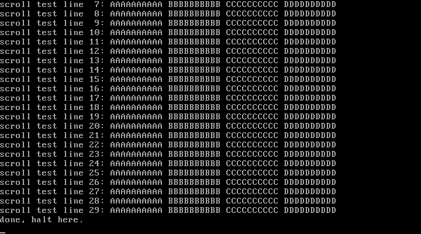

# 3P2 实现格式化打印：console + vsprintf + printk

对应书中 **3.2 实现格式化打印**（初始化终端 / 操作显示控制器 / 支持换行回车 / 格式化打印结果并输出）。

## 实验目的

1. 在 3P1 的基础上给内核装上"嘴巴"：`printk` 从此成为所有后续实验的调试输出手段
2. 掌握 VGA 文本模式编程：显存布局（0xB8000，每字符 2 字节）、
   6845 光标寄存器（索引口 0x3D4 / 数据口 0x3D5 的 14/15 号寄存器）
3. 掌握换行 '\n'、回车 '\r'、制表 '\t'、行尾自动换行与整屏上滚的实现
4. 理解 vsprintf 的通用套路：解析 `%[flags][width][l]specifier`

## 新增文件

| 文件 | 对应官方仓 | 说明 |
| ---- | ---------- | ---- |
| `console.c` | `kernel/chr_drv/console.c`（精简版） | 光标/换行回车/滚屏；tty 队列与转义序列留给第 5 章 |
| `vsprintf.c` | `kernel/vsprintf.c`（精简版） | %d %u %x %X %c %s %p %% + 宽度/补零/左对齐 |
| `printk.c` | `kernel/printk.c` | vsprintf + con_puts 的组合出口 |
| `kernel.h` | 官方 include/ 目录的缩影 | 类型、端口 IO 原语、函数声明 |

## 运行效果



```
[3P2] format print works
dec : 0 123 -456
hex : 0xdeadbeef 0x0000002a
str : hello kernel, char: LX!
width: [      42][42      ][00000042]
ptr : 0000b800
scroll test line  0..29        <- 30 行把开机信息顶出屏幕（滚屏）
done, halt here.
```

## 运行步骤

```bash
make
sh run.sh
```

## 常见问题

1. **光标为什么要自己更新？** 直接写显存 CPU 不会自动移硬件光标，
   不更新 0x3D4/0x3D5 的话光标会一直停在开机时的位置
2. **'\n' 和 '\r' 为什么要分开处理？** 串行终端时代的历史习惯：LF 只下移一行不回行首，
   CR 只回行首不下移。内核打印 "\n\r" 连用达到"回车换行"效果，与官方仓字符串一致
3. **滚屏为什么不用 rep movsw？** C 循环更易读；追求性能可以像 0.11 一样
   在汇编排 rep movsl，官方仓 console.c 的 scrup 就是这么做的
