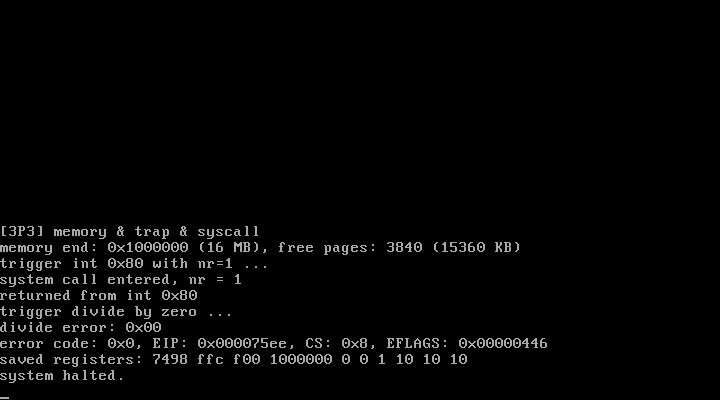

# 3P3 设置内存和陷阱处理：mem_init + CPU 异常 + 系统调用骨架

对应书中 **3.3 设置内存和陷阱处理**（初始化内存管理 / 初始化系统调用 / 处理CPU异常）。

## 实验目的

1. **内存管理初始化**：用 mem_map 字节数组管理物理页（一页 4KB），
   0=已用、1=空闲、>1=共享引用（写时复制在第 4 章）
2. **CPU 异常处理**：把 IDT 的 0 号（除零）、6 号（非法操作码）改挂到
   真正的处理桩，异常发生时打印完整现场（错误码/EIP/CS/EFLAGS/寄存器）
3. **系统调用骨架**：0x80 号中断门（DPL=3），验证 `int 0x80` 的进出机制
   ——EAX 传调用号，处理完 iret 返回

## 新增文件

| 文件 | 对应官方仓 | 说明 |
| ---- | ---------- | ---- |
| `memory.c` | `mm/memory.c`（mem_init 部分） | mem_map 位图：标记 [1MB, 16MB) 共 3840 页空闲 |
| `asm.S` | `kernel/asm.S`（子集） | divide_error / invalid_op / system_call 三个入口桩 |
| `traps.c` | `kernel/traps.c`（子集） | set_gate 写 IDT 门 + die() 现场打印 |
| `syscall.c` | `kernel/sys_call.S` + `sys.c` 的雏形 | sys_demo 演示调用号传递 |

## 运行效果



```
[3P3] memory & trap & syscall
memory end: 0x1000000 (16 MB), free pages: 3840 (15360 KB)
trigger int 0x80 with nr=1 ...
system call entered, nr = 1
returned from int 0x80
trigger divide by zero ...
divide error: 0x00
error code: 0x0, EIP: 0x000075ee, CS: 0x8, EFLAGS: 0x00000446
saved registers: 7498 ffc f00 1000000 0 0 1 10 10 10
system halted.
```

`EIP 0x75ee` 正是 main() 里 idivl 指令的地址，CS=0x8 是内核代码段选择子。

## 运行步骤

```bash
make
sh run.sh
```

## 本实验踩过的三个坑（都值得记住）

1. **C 语言除零会被 gcc 整个优化掉**——即使除数是 volatile 变量，
   因为除零是未定义行为，编译器可以直接删除。要触发 0 号异常必须用
   内嵌汇编 `idivl` 强制生成指令
2. **`extern void *idt` 与 `extern unsigned long idt[]` 天差地别**——
   前者把 idt 当指针变量（读的是表头 8 字节的值），set_gate 写飞到无关内存；
   数组声明才能拿到 head.S 里 idt 标号的真实地址
3. **C 函数参数必须最后压栈**——汇编桩里先保存了一堆寄存器再 `call`，
   结果最后压栈的是 EBX，C 侧拿到的"调用号"就成了 EBX 的值（16777216）。
   正确做法：保存完寄存器后，把参数单独 `pushl 12(%esp)` 再 call

## 常见问题

1. **为什么除零处理完要停机？** 除零是 fault 类异常，iret 回到的还是
   出错指令本身，继续返回就是无限异常循环。真实内核会向出错进程发信号
   （SIGFPE）或直接终止它；单进程实验里打印完停机最直观
2. **异常门 DPL=0、系统调用门 DPL=3 的区别？** DPL=0 的门只允许内核态
   （int 指令在 CPL=0 时）进入；0x80 号门 DPL=3，用户程序（CPL=3）执行
   int 0x80 才不会触发通用保护异常——这是所有系统调用的入口约定
3. **错误码为什么是 0？** 0 号异常（除零）本身不压错误码，桩里补的 0；
   有错误码的异常（如 14 号缺页）CPU 会自动压入，那时桩就不用补了
