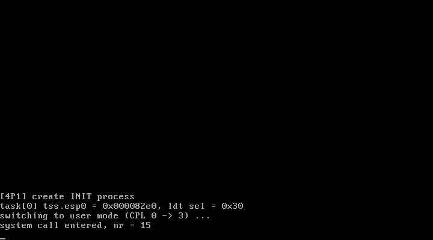

# 4P1 创建INIT进程：task_struct + 特权级切换

对应书中 **4.1 创建INIT进程**（4.1.1 创建进程控制块 / 4.1.2 切换特权级）。

## 实验目的

1. **创建进程控制块**：task_struct（调度字段、LDT、TSS）+ 任务表 task[] + INIT_TASK 初值
2. **把进程"介绍"给 CPU**：TSS/LDT 描述符写进 GDT 第 5/6 项，ltr/lldt 加载
   ——从此用户态↔内核态切换时 CPU 知道去 TSS 里取 SS0:ESP0
3. **切换特权级（move_to_user_mode）**：伪造 iret 现场从 CPL0 降到 CPL3

## 新增文件

| 文件 | 对应官方仓 | 说明 |
| ---- | ---------- | ---- |
| `sched.h` | `include/linux/sched.h`（裁剪） | task_struct、tss_struct、_TSS/_LDT 宏、task_union |
| `sched.c` | `kernel/sched.c`（sched_init 部分） | init_task、task[]、stack_start、set_tssldt_desc、move_to_user_mode |

`head.S` 的变化：内核启动栈（stack_start）从 head.S 挪到 sched.c（user_stack），
INIT 进程自己的内核栈在 init_task 的 4KB 页内（tss.esp0 = 页顶）。

## 验证特权级切换的证据

```
[4P1] create INIT process
task[0] tss.esp0 = 0x000082e0, ldt sel = 0x30
switching to user mode (CPL 0 -> 3) ...
system call entered, nr = 15
```

最后一行 `nr = 15`（0x0F）是**用户态代码读出自己的 CS 选择子**（LDT 用户代码段
1<<3|TI|3 = 0x0F）后经 int 0x80 传给内核打印的——一次输出同时证明了：

- move_to_user_mode 成功（否则 CS 是内核段 0x08）
- 用户态能发起系统调用（0x80 号门 DPL=3 放行）
- CPU 从 TSS 取 SS0:ESP0 切到内核栈再进处理程序（往返栈切换正确）

## 运行效果



## 运行步骤

```bash
make
sh run.sh
```

## 本实验踩过的坑（都很典型，值得记住）

1. **GDT 下标的指针运算陷阱**：GDT 每项 8 字节，但 `unsigned long gdt[]`
   的元素是 4 字节——`gdt + 5` 按指针运算只前进 20 字节（第 2.5 项）！
   必须乘 2：第 N 项 = `gdt + 2*N`。官方仓的 gdt 声明是 `desc_struct*`
   （8 字节单元）所以 `gdt+5` 恰好正确，换成 ulong 数组就埋了雷。
   本实验把 entry 号做参数、函数内部换算，调用方不再踩坑
2. **#GP 的错误码就是肇事选择子**：ltr 触发 #GP(0x28)，0x28 = 5<<3 = TSS
   选择子——看到"错误码 == 你正在加载的选择子"，就去查它指向的描述符
3. **lgdt 后 CS 描述符缓存不刷新**：lgdt 只换表，段寄存器的隐藏描述符
   要等下次段寄存器重载才更新。所以调试时看到 CS limit 还是 setup 的
   8MB（head.S 的 GDT 是 16MB）不必慌，只要地址都在范围内就无害
4. **编辑代码时旧循环没删干净**：修了下标 bug 后旧的清零循环还在源文件里，
   跑起来把刚写好的描述符又清成 0——症状是"写入凭空消失"。
   排查方法：反汇编最终二进制按地址核对（`objdump -D -b binary -m i386 system`）

## 常见问题

1. **为什么 move_to_user_mode 用 iret 而不是远跳转？** 远跳转（ljmp）只能
   在同为 CPL0 的代码段间跳，或跳到 TSS/调用门触发任务切换；想让 CPU 降特权级，
   最干净的办法就是伪造"中断返回现场"让它 iret 到 RPL=3 的段
2. **用户态为什么不能用 printk？** printk 是内核函数（地址在内核代码段，用户
   CS 够不着），且用户数据段限长 640KB 到不了内核数据。所以用户态输出
   只能走系统调用——这正是操作系统设计使然
3. **任务 0 的用户态为什么用内核栈？** 任务 0 是特殊进程（书中的 INITPROC），
   它的"用户态"代码是 main() 的直接延续，0.11 系内核让它借用当前栈；
   从它 fork 出的任务 1 起才有自己独立的用户栈
