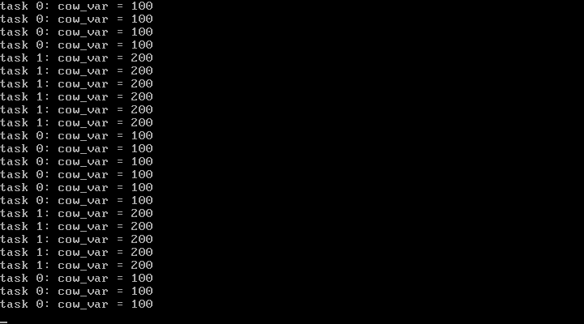

# 4P3 第一个系统调用fork：进程复制 + 写时复制 + 缺页中断

对应书中 **4.3 第一个系统调用fork**（系统调用和中断 / 定义fork / 写时复制 / 页保护中断 / 完善调度器）。

## 实验目的

1. **完整的系统调用链**：int 0x80 → system_call 桩保存全部现场（pt_regs）→
   按调用号分发 → 返回值写回 pt_regs->eax
2. **fork**：find_empty_process 找空位 → copy_process 复制 task_struct、
   拷贝父进程现场（子进程 EAX=0，父拿到 pid）→ copy_mem 建立 64MB 独立空间
3. **写时复制（COW）**：copy_page_tables 复制页表时父子都改只读、引用计数+1；
   子进程写共享页触发 14 号缺页 → do_wp_page 复制私有页
4. **地址空间模型**：每任务 64MB（task n = 线性 64n MB），全部任务共享一张
   页目录（CR3=0），LDT 段基址 = 64n MB

## 新增文件

| 文件 | 对应官方仓 | 说明 |
| ---- | ---------- | ---- |
| `memory.c`（重写） | `mm/memory.c` | get/free_page（引用计数）、copy/free_page_tables（COW 复制）、un_wp_page/do_wp_page |
| `fork.c` | `kernel/fork.c` | find_empty_process、copy_process、copy_mem、sys_fork |
| `page.S` | `mm/page.S` | 缺页入口桩：xchgl 换错误码、读 CR2、按 bit0 分发 wp/no_page |
| `asm.S`（重写 system_call） | `kernel/sys_call.S` | 全寄存器现场按 pt_regs 布局压栈，双参数传递 |
| `sched.h` | 增加 pt_regs、TASK_SIZE、fork 声明 |

## 运行效果



```
[4P3] fork + copy-on-write
free pages: 3840
task 0: fork() returned 1        <- 父进程拿到子进程 pid
task 1: cow_var = 200            <- 子进程写后看到自己的私有副本
task 0: cow_var = 100            <- 父进程看到的仍是原值
task 1: cow_var = 200
task 0: cow_var = 100            <- 时钟调度轮转，两进程交替运行
...
```

同一个全局变量 cow_var，父子各自看到 100/200 —— **写时复制让 fork
后看似共享的内存悄悄分化**，这就是 fork 语义的核心。

## 运行步骤

```bash
make
sh run.sh
```

## 本实验踩过的坑（三个，每个都极有价值）

1. **head.S 的 std 忘了恢复（本仓库最隐蔽的 bug）**：setup_paging 用 `std`
   反向填页表后没有 `cld` 恢复方向标志。gcc 编译的 `*p = *current` 结构体
   拷贝按 ABI 假定 DF=0，不插 cld 直接 `rep movs`——DF=1 时拷贝反向进行，
   子进程页面除了第 1 个长字全是 get_free_page 清出的零。症状是"拷贝的
   字段全是零、显式赋值的字段正常"。教训：**汇编改动方向标志必须配对恢复**
2. **pt_regs 压栈顺序必须与结构体布局严格一致**：第一版压栈结尾是
   edx,ecx,ebx,eax，内存里 eax 落在 offset 0，C 侧读"regs->ebx"拿到的是
   EAX（调用号）——打印出 "cow_var = 4"（4 是调用号！）。正确顺序：压栈
   结尾 eax,edx,ecx,ebx（最后压的在最低地址）
3. **调试编辑时把 return 语句替换掉了**：copy_mem 的 copy_page_tables 调用
   被调试块意外顶替，页表根本没复制，症状是子进程取指缺页 not-present。
   多轮调试后靠"在内核里打印 dir[16]"才定位。教训：**删除调试代码后必须
   核对业务逻辑完整性**

## 与官方仓代码的对应关系

| 本实验 | 官方仓 linux_kernel_012 |
| ------ | ----------------------- |
| memory.c 全部 | `mm/memory.c`（本版去掉了 share_page/try_to_share 的 exec 共享逻辑，7P6 引入） |
| fork.c | `kernel/fork.c`（本版 pid 不查重，进程不退出） |
| page.S | `mm/page.S` 同构 |
| system_call 现场 | `kernel/sys_call.S`（官方还有信号检查、重调度判断，逐步引入） |

## 常见问题

1. **为什么子进程线性地址在 64MB 起而物理页在 0~640KB？** LDT 段基址
   64MB + 偏移 → 页表把"64MB+页号"映射回父进程在用的物理页（只读）。
   写时复制后子进程的该页指向新分配的物理页（≥1MB 池）
2. **父进程为什么不写 cow_var？** task0 的线性空间（0 起）与内核重叠，
   写自己的页会走 do_wp_page 重映射——本实验的 do_wp_page 放开了官方的
   TASK_SIZE panic 检查可以处理，但为了演示"父读旧值/子读新值"的对比，
   父进程保持只读
3. **内核自己写被标只读的页为什么不缺页？** CR0.WP=0（head.S 开分页只置
   PG 位）：x86 规定 WP=0 时内核态写不受只读位约束。0.11 正是靠这个让
   task0 的用户空间与内核共存——COW 只对用户态生效
4. **do_no_page 什么时候才有真实现？** exec（7P6）需要按需调页时——现在
   只报错停机
