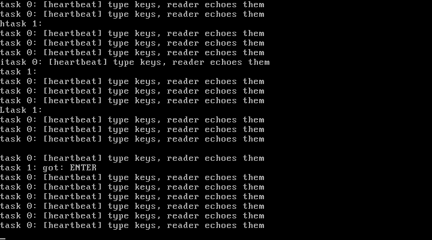

# 5P1 支持键盘：IRQ1 + 扫描码解析 + 环形缓冲 + 睡眠唤醒

对应书中 **5.1 支持键盘**（键盘的工作原理 / 解析扫描码 / 构建缓冲区 / 完善屏幕回显）。

## 实验目的

1. **键盘工作原理**：按键 → 8042 控制器 → IRQ1 → 从端口 0x60 读扫描码
   （Set 1：通码=按下，通码|0x80=松开；0x2A/0x36 是 Shift）
2. **扫描码解析**：查表（普通/Shift 两张映射表）转 ASCII，断码读掉丢弃
3. **环形缓冲区**：中断生产（kbd_put）、系统调用消费（kbd_getchar）
4. **睡眠与唤醒**：缓冲空时读者任务睡眠（state=UNINTERRUPTIBLE + schedule），
   键盘中断收到字符后把它唤醒——内核阻塞 IO 的基本模型

## 新增文件

| 文件 | 对应官方仓 | 说明 |
| ---- | ---------- | ---- |
| `keyboard.c` | `kernel/chr_drv/kboard.c`（精简） | 扫描码表、环形缓冲、kbd_getchar 阻塞读、kbd_init |
| `asm.S` 追加 | `kernel/chr_drv/keyboard.S` | keyboard_interrupt 桩（存现场→C 处理→EOI→iret） |
| `syscall.c` | 增加 sys_getchar（nr=6）与 sys_idle（nr=7，hlt 睡眠） |

## 运行效果



按 h、i、回车后的屏幕（qemu sendkey 注入）：

```
htask 0: [heartbeat] type keys, reader echoes them
task 1:
itask 0: [heartbeat] type keys, reader echoes them
task 1:
task 1: got: ENTER
```

- 行首的 `h`/`i` 是**键盘中断的直接回显**（中断上下文 con_putc）
- `task 1: got: ENTER` 是**读者任务**从缓冲取出字符后的打印——
  它在缓冲空时睡眠，中断把它叫醒

## 运行步骤

```bash
make
sh run.sh
```

在 qemu 窗口里直接敲键盘即可看到回显与 got: 输出。

## 本实验最重要的教训：绝不能在系统调用里忙等

第一版 kbd_getchar 在缓冲空时**空转等待**——但 int 0x80 是中断门，
进入时 CPU 自动关中断（IF=0）。读者任务在内核里空转 → 时钟中断永远
进不来 → 调度器瘫痪 → 系统僵死在第一个 getchar 上。

正确做法就是睡眠/唤醒（本书 5.2 节的主题，本实验提前实现了最小版）：

```
读者: while (缓冲空) { state = 不可运行; schedule(); }   ← 切走，让出 CPU
中断: 字符入缓冲后, 把睡眠任务的 state 改回就绪            ← 下次调度它跑
```

配套教训：**hlt 被中断唤醒后 IF 已被中断门清零**，循环里 hlt 前必须重新
sti（`sti; hlt`），否则第二次 hlt 永眠。

## 与官方仓代码的对应关系

| 本实验 | 官方仓 linux_kernel_012 |
| ------ | ----------------------- |
| keymap 两张表 | `kernel/chr_drv/kboard.c` 的 key_table 函数指针表（官方按处理函数分发，本版简化为查表） |
| keyboard_interrupt 桩 | `kernel/chr_drv/keyboard.S` 同构 |
| 环形缓冲 | `include/linux/tty.h` 的 read_q/write_q（第 5.2 节展开成完整 tty 结构） |
| 睡眠唤醒 | `kernel/sched.c` 的 sleep_on/wake_up（本版是单元素等待队列的直白版） |

## 常见问题

1. **为什么中断里直接回显，而不是等任务来打？** 回显要"按键立刻可见"，
   中断上下文直写控制台最直接；代价是 con_putc 必须可在中断里重入。
   官方内核通过 tty 写队列让回显也走任务上下文（5.3 节）
2. **Shift 怎么处理？** 通码 0x2A/0x36（左/右 Shift 按下）置状态位，
   断码（0xAA/0xB6）清除；后续字符按状态查 keymap_shift
3. **缓冲满了怎么办？** 本版直接丢弃（真实内核会响铃）；环形缓冲的
   意义正是解耦"中断产生的速率"与"任务消费的速率"
