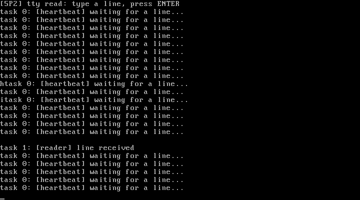

# 5P2 优化输入功能：tty 层 + 规范模式阻塞 read

对应书中 **5.2 优化输入功能**（控制台和远程终端 / read系统调用）。

## 实验目的

1. **终端抽象层（tty）**：在"设备驱动"和"系统调用"之间插入 tty_struct——
   键盘中断 → secondary 队列（攒行）→ read 系统调用取走。控制台和
   串口终端从此共享同一套 read/write 接口
2. **规范模式（canonical）读**：回车前的字符只攒行+回显，不唤醒读者；
   '\n' 到达才交付一整行——shell 的读法
3. **阻塞 read**：缓冲没行时任务睡眠（UNINTERRUPTIBLE + schedule），
   tty_do_char 收到回车唤醒——5P1 教训的直接应用

## 新增文件

| 文件 | 对应官方仓 | 说明 |
| ---- | ---------- | ---- |
| `tty.h` | `include/linux/tty.h`（精简） | tty_queue、tty_struct |
| `tty.c` | `kernel/chr_drv/tty_io.c`（重写） | tty_do_char 攒行+唤醒、tty_read 阻塞读 |
| `keyboard.c` | 修改 | 中断改为喂 tty 层；kbd_getchar 由 tty_read 取代 |
| `syscall.c` | nr=6 变 read(0, buf, n)：EBX=用户缓冲 ECX=长度 |

## 运行效果



按键 h、i，再按回车：

```
htask 0: [heartbeat] waiting for a line...     <- 回显，但读者没醒
itask 0: [heartbeat] waiting for a line...     <- 继续攒行
task 1: [reader] line received                 <- 回车后 read 返回整行
```

与 5P1 的差别：5P1 每个按键唤醒一次；5P2 攒到回车才交付——**这是
规范模式（行编辑）与非规范模式（逐字符）的分界，termios 的 ICANON 位
（5.4 节）控制的就是它**

## 运行步骤

```bash
make
sh run.sh
```

## 踩坑记录

1. **演示任务的循环里必须保留 hlt 睡眠（sys_idle）**：把 5P1 的
   idle 调用去掉后，qemu TCG 被纯用户态忙转饿死，sendkey 事件根本
   处理不到——现象与"键盘坏了"一模一样。真实硬件不会有这个问题，
   但它生动地展示了为什么 idle 进程必须是 hlt 而不是空转
2. 队列满/空判断、line_complete 的复位时机（取完一行清零）都是
   tty_read 的细节坑

## 与官方仓代码的对应关系

| 本实验 | 官方仓 linux_kernel_012 |
| ------ | ----------------------- |
| tty_queue / tty_struct | `include/linux/tty.h`（官方还有 write_q/read_q 分离、termios 字段） |
| tty_read 的睡眠唤醒 | `kernel/chr_drv/tty_io.c` 的 read_chan（官方用 sleep_on） |
| 键盘中断喂 tty | 官方经 copy_to_cooked 做"熟化"（回显、攒行、特殊字符处理） |
