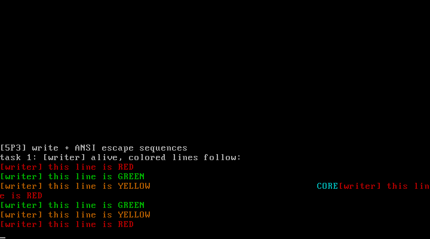

# 5P3 优化输出功能：write 系统调用 + ANSI 转义序列

对应书中 **5.3 优化输出功能**（写标准输出 / ANSI转义序列 / 支持转义序列）。

## 实验目的

1. **write 系统调用**（nr=8）：用户程序的输出口——逐字节透传给控制台
2. **ANSI 转义序列状态机**：终端模拟器的最小骨架
   - `ESC [ <参数> m`：颜色（0 复位 / 30-37 前景 / 40-47 背景）
   - `ESC [ <行>;<列> H`：光标定位
   - 状态机三态：NORMAL →(0x1b)→ ESC →('[')→ CSI →(终结字母)→ 执行

## 实现

| 文件 | 变化 |
| ---- | ---- |
| `console.c` | cur_attr 全局属性 + ansi_handle/ansi_csi_exec 状态机；定位用 CRT 寄存器直接移光标 |
| `syscall.c` | nr=8 write(1, buf, n)，逐字符 con_putc（转义序列被状态机消费不占屏） |
| `main.c` | writer 任务循环输出红/绿/黄三行 + 右下角定位角标 |

## 运行效果



屏幕出现红色、绿色、棕色（ANSI 黄在 VGA 上的近似）三行消息，
右下角青色 CORE 角标（24;60H 定位）——转义序列在内核终端里生效。

## 运行步骤

```bash
make
sh run.sh
```

## 教学要点（含两个坑）

1. **ANSI 色号与 VGA 属性的顺序不同**：ANSI 30-37 是"黑红绿黄蓝紫青白"，
   VGA 属性 0-7 是"黑白红绿蓝紫青黄"——直接 `p1-30` 会把红色显示成蓝色
   （本项目实测踩过），必须查表重排 `{0,4,2,6,1,5,3,7}`
2. **write 的长度参数**：内核按 `\0` 截断字符串，但调用方传 n=0 的话
   循环直接不执行（实测踩过）——系统调用的每个参数都要认真传
3. **光标定位后输出继续从新位置开始**（row19 出现 "e is RED" 接在角标后）：
   这是终端的语义，恢复位置是调用方（shell 提示符）的责任

## 与官方仓代码的对应关系

| 本实验 | 官方仓 linux_kernel_012 |
| ------ | ----------------------- |
| ANSI 状态机 | `kernel/chr_drv/console.c` 的 con_write 转义分支（官方支持 ESC [ 系列更完整） |
| write 路径 | 官方 sys_write → tty_write → con_write（经写队列；本版直写控制台） |
