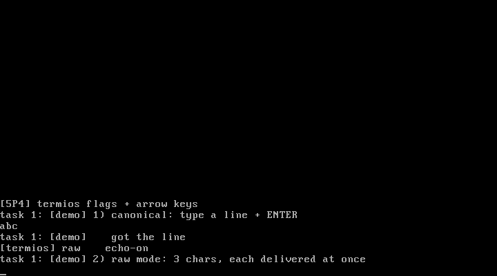

# 5P4 修改终端状态：termios 标志位 + 方向键

对应书中 **5.4 修改终端状态**（方向键 / 控制台标志位）。

## 实验目的

1. **termios 标志位**：TTY_ICANON（规范/原始模式切换）、T_ECHO（回显开关）
   ——vim、密码输入等功能背后就是这两个位的切换
2. **ioctl 系统调用**（nr=9）：用户程序修改终端状态的通道
3. **扩展键扫描码**：E0 前缀 + 方向键通码——方向键直接移动屏幕光标

## 实现

| 文件 | 变化 |
| ---- | ---- |
| `tty.h` | tty_struct 增加 termios 字段与 T_ICANON/T_ECHO 定义 |
| `tty.c` | tty_do_char 按 ICANON 决定攒行/即交付；tty_ioctl 切标志 |
| `keyboard.c` | 回显受 T_ECHO 控制；E0 前缀识别 → 左键退格、右键前进 |
| `syscall.c` | nr=9 ioctl(0, cmd)：cmd=1 切 ICANON、cmd=2 切 ECHO |

## 运行效果



```
[5P4] termios flags + arrow keys
task 1: [demo] 1) canonical: type a line + ENTER
abc                              <- 规范模式：攒行
task 1: [demo]    got the line
[termios] raw    echo-on
task 1: [demo] 2) raw mode: 3 chars...
xtask 1: [demo]    raw char delivered    <- 原始模式：逐字符交付
ytask 1: [demo]    raw char delivered
ztask 1: [demo]    raw char delivered
[termios] canonical echo-off
task 1: [demo] 3) echo off: type...      <- 密码模式：输入无回显
task 1: [demo]    (echo was off) got the line
[termios] canonical echo-on
task 1: [demo] done. arrow keys move the cursor!
```

## 运行步骤

```bash
make
sh run.sh
```

## 教学要点

1. **原始模式 vs 规范模式**：交互式程序（编辑器、shell 的 tab 补全）用
   原始模式逐字符拿输入自己做处理；普通命令行用规范模式让内核攒行
2. **E0 前缀**：101 键盘的方向键/小键盘扫描码是两字节（0xE0 + 通码），
   驱动需要一个"前缀状态"。上下键涉及行内定位，本实验用左右键演示
3. **termios 是 tty_struct 的一部分**：修改的是"终端设备的状态"而非
   进程状态——所以对 tty 的读写行为全局生效（一个终端只有一个读者）

## 与官方仓代码的对应关系

| 本实验 | 官方仓 linux_kernel_012 |
| ------ | ----------------------- |
| T_ICANON/T_ECHO | 官方 termios 的 c_lflag（ICANON/ECHO 位） |
| tty_ioctl | `kernel/chr_drv/tty_ioctl.c` 的 change_ldisc 相关逻辑 |
| E0 前缀 | `kernel/chr_drv/kboard.c` 的 E0 状态处理 |
