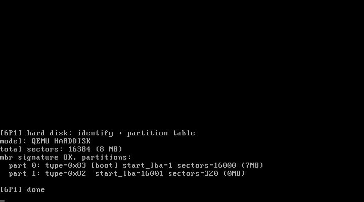

# 6P1 硬盘的基本结构：ATA 探测 + MBR 分区表

对应书中 **6.1 硬盘的基本结构**（初始化硬盘信息 / 读取分区表）。
来源：官方仓 `kernel/blk_drv/hd.c` 的教学精简版。

## 实验目的

1. **ATA(PIO) 编程模型**：主通道 0x1F0-0x1F7 的寄存器布局，
   命令流程（写扇区数/LBA → 写命令 → 等 DRQ → 读数据口）
2. **IDENTIFY DEVICE**（0xEC）：读回设备信息——型号（第 27-46 字，字节对大端）
   与总扇区数（第 60/61 字）
3. **MBR 分区表**：0 号扇区末尾 0x55AA 签名；偏移 446 起每 16 字节一项
   （活动标志/CHS/类型/起始 LBA/扇区数），共 4 项

## 运行效果



```
[6P1] hard disk: identify + partition table
model: QEMU HARDDISK
total sectors: 16384 (8 MB)
mbr signature OK, partitions:
  part 0: type=0x83 [boot] start_lba=1 sectors=16000 (7MB)
  part 1: type=0x82  start_lba=16001 sectors=320 (0MB)
```

## 运行步骤

先构造测试硬盘（8MB，含 MBR 分区表）：

```bash
python3 -c "
import struct
img = bytearray(8*1024*1024)
p1 = bytes([0x80,0x20,0x21,0,0x83,0x30,0x33,0]) + struct.pack('<II', 1, 16000)
p2 = bytes([0x00,0x40,0x41,0,0x82,0x50,0x53,0]) + struct.pack('<II', 16001, 320)
mbr = bytearray(512); mbr[446:462] = p1; mbr[462:478] = p2; mbr[510:512] = b'\x55\xaa'
img[0:512] = mbr
open('/tmp/testhd.img','wb').write(img)
"
make
sh run.sh    # qemu -boot a -fda linux.img -hda /tmp/testhd.img
```

## 踩过的坑

**IDE 数据口必须用 16 位 inw 读**——第一版用两次 inb 拼 16 位，
IDENTIFY 数据读得残缺（型号空、扇区数 0）。0x1F0 是 16 位寄存器，
每条 inw 恰好取走 DRQ 数据的一个字；用 8 位口读法会破坏传输流。

## 与官方仓代码的对应关系

| 本实验 | 官方仓 linux_kernel_012 |
| ------ | ----------------------- |
| ATA 寄存器/命令 | `kernel/blk_drv/hd.c` 的 port 定义与 hd_request |
| hd_info 雏形 | `hd_info[]`（圆柱/磁头/扇区几何，本版只存总扇区数） |
| 读分区表 | 官方在 sys_setup 里（mount 根分区前解析） |
| hd_read_sector | 后续 6P3 改造成请求队列 + IRQ14 中断完成 |
