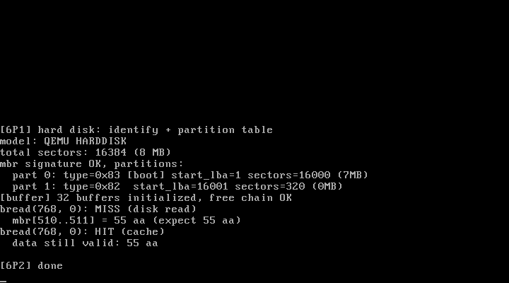

# 6P2 管理缓冲区：buffer_head 池 + 哈希链 + LRU

对应书中 **6.2 管理缓冲区**（初始化 / 申请 / 读写缓冲区）。
来源：官方仓 `fs/buffer.c` 的教学精简版。

## 实验目的

1. **为什么需要缓冲区**：读盘前查缓存（命中免读盘）、写盘先攒缓存——
   0.11 的整个文件系统都垫在这层之上
2. **buffer_head 结构**：1KB 数据区 + 设备号/块号/引用计数/状态 + 两条链
3. **哈希链查找**：dev+blocknr 散列到桶，O(1) 判断"块在不在缓存"
4. **空闲双向链环 + 近似 LRU**：申请从链尾取（最近最久未用），
   brelse 放回链头并 touch；命中时也 touch（挪到链头）

## 运行效果



```
[buffer] 32 buffers initialized, free chain OK
bread(768, 0): MISS (disk read)
  mbr[510..511] = 55 aa (expect 55 aa)
bread(768, 0): HIT (cache)
  data still valid: 55 aa
```

同一块（主盘 0 号 = MBR）读两遍：第一次 MISS 触发读盘，第二次
HIT 直接从缓存返回——高速缓冲的价值一目了然。

## 运行步骤

与 6P1 相同：先构造 /tmp/testhd.img（见 6P1 的 README），然后：

```bash
make
sh run.sh
```

## 教学要点

1. **getblk 的三段逻辑**：命中（b_count++ 返回）→ 未命中取空闲链尾 →
   换绑 dev/block 并重新挂哈希链。链尾 = LRU 的"牺牲者"
2. **b_count 引用计数**：count>0 的块不在"可回收"范围——多个任务
   同时读同一块时数据不会被中途顶掉
3. **b_dirt 脏位**：写路径（bwrite/写回）在 7 章文件系统里才用到，
   本实验先留字段
4. **块大小 1KB**：0.11 的逻辑块 = 2 个磁盘扇区，7 章的文件系统块
   也是 1KB

## 与官方仓代码的对应关系

| 本实验 | 官方仓 linux_kernel_012 |
| ------ | ----------------------- |
| buffer_head / hash_table / free_list | `fs/buffer.c` 同款设计（官方 3072 块、NR_HASH 997） |
| getblk 的 LRU | 官方 getblk 里被等待/锁定的块会跳过（本版教学规模不涉及并发） |
| bread | 官方 bread 走 ll_rw_block 异步读 + wait_on_buffer 睡眠（6P3 引入请求队列后对齐） |
