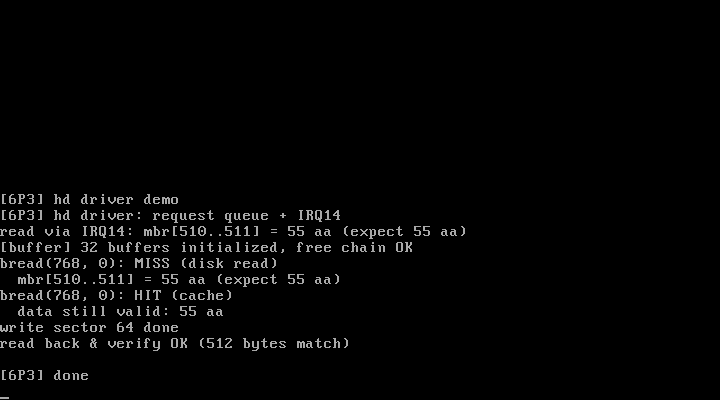

# 6P3 硬盘驱动：请求队列 + IRQ14 中断驱动读写

对应书中 **6.3 硬盘驱动**（读写硬盘 / 读分区表）。
来源：官方仓 `kernel/blk_drv/hd.c` + `ll_rw_blk.c` 的教学精简版。

## 实验目的

1. **块设备请求队列模型**：上层把读写请求挂队 → 控制器空闲即发起 →
   完成后中断里继续发起下一个——所有块设备（硬盘/软盘）共用此模型
2. **中断驱动替代轮询**：6.1 的 CPU 轮询等 DRQ 变成"发起后睡眠，
   IRQ14 到达后处理"，等待期间 CPU 给别的任务用
3. **写路径**：ATA 命令 0x30（WRITE SECTORS）+ outw 灌数据 + 写后读回校验

## 数据流

```
bread/hd_read_write_demo
   └─ hd_do_request: 挂请求 → 队列空则 hd_start(ATA编程) → 睡眠
        硬盘完成 → IRQ14 → hd_interrupt(asm) → hd_interrupt_handler(C)
            读命令: inw 读 256 字进缓冲
            hd_complete: 标记完成 → 队列非空则 hd_start(下一个) → 唤醒等待者
   └─ 醒来校验数据
```

## 运行效果



```
[6P3] hd driver: request queue + IRQ14
read via IRQ14: mbr[510..511] = 55 aa (expect 55 aa)   <- 中断驱动读
[buffer] 32 buffers initialized, free chain OK
bread(768, 0): MISS (disk read)                        <- 缓冲区走请求队列
bread(768, 0): HIT (cache)
write sector 64 done                                   <- 写路径
read back & verify OK (512 bytes match)                <- 读回校验
```

## 运行步骤

```bash
make
sh run.sh    # qemu -boot a -fda linux.img -hda /tmp/testhd2.img（干净盘）
```

## 踩过的坑（级联中断的经典错误）

**IRQ14 挂在从片上，从片经 IRQ2 级联到主片——两个 IMR 位都要开**：
第一版只开了从片 bit6（0xA1 的 IRQ14），主片 bit2（0x21 的 IRQ2）还
被 setup.S 的 0xFF 屏蔽着——IRQ14 信号走到主片就被挡住，CPU 永远收
不到，系统僵死在第一次读盘。级联设备的 IMR 必须成对检查。

另一个坑：**睡眠等中断的代码必须在 sti 之后跑**——hd_init 曾在
main 的 sti 之前调用，IF=0 时发起了请求却收不到完成中断，死锁。

## 与官方仓代码的对应关系

| 本实验 | 官方仓 linux_kernel_012 |
| ------ | ----------------------- |
| request[] 队列 | `kernel/blk_drv/ll_rw_blk.c` 的 request[] 与 add_request |
| hd_start/ATA 编程 | `kernel/blk_drv/hd.c` 的 hd_out |
| IRQ14 处理 | 官方 read_intr/write_intr 状态机（区分多扇区续传） |
| 睡眠等完成 | 官方 wait_on_buffer（挂在 buffer_head 上） |
