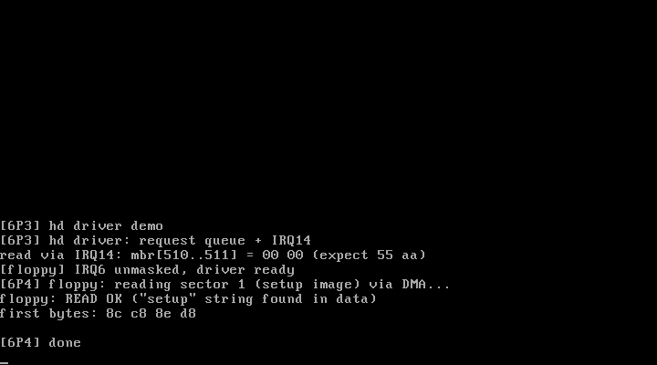

# 6P4 软盘驱动：FDC 编程 + 8237 DMA 传输

对应书中 **6.4 软盘驱动**（软盘的原理 / 定时器 / DMA / 控制器 / 操作函数）。
来源：官方仓 `kernel/blk_drv/floppy.c` 的教学精简版（单驱、1.44MB、读扇区）。

## 实验目的

1. **FDC(μPD765) 编程模型**：0x3F2 DOR（马达/使能/复位）、0x3F4 主状态
   （RQM/DIO 位决定数据口方向）、0x3F5 数据口（命令/参数/结果逐字节进出）
2. **8237 DMA 通道 2**：mask/清触发器/模式/地址(3字节:低8+高8+页面寄存器)/计数
   ——数据由 DMA 直接灌进内存缓冲，CPU 不碰一个字节
3. **完整读扇区序列**：复位脉冲 → 排空 4 次 SENSE → 马达起转延时 →
   SPECIFY → SEEK(等中断) → DMA 就位 → READ(9字节) → IRQ6 → 7 字节结果

## 运行效果



```
[floppy] IRQ6 unmasked, driver ready
[6P4] floppy: reading sector 1 (setup image) via DMA...
floppy: READ OK ("setup" string found in data)
first bytes: 8c c8 8e d8
```

读的是**启动盘本身的 1 号扇区**（setup 程序的前 512 字节）——首字节
`8c c8 8e d8` 正是 setup.S 开头 `mov %cs,%ax / mov %ax,%ds` 的机器码，
数据正确性由内容直接验证。

## 运行步骤

```bash
make
sh run.sh    # 无需硬盘，内核软盘就是被读的盘
```

## 踩过的坑（FDC 状态机的三道坎）

1. **FDC 复位后必须先 SPECIFY 才能 SEEK/READ**——第一版直接 SEEK，
   ST0=0xe0（异常终止）。FDC 复位后处于未指定操作模式
2. **复位脉冲本身是必须的**：DOR bit2 先清后置，且复位会产生 4 个中断，
   要用 SENSE INTERRUPT STATUS 逐个排空，否则后续中断语义混乱
3. **马达起转延时**：写 DOR 开马达后立即操作，盘片转速未稳——约 0.5 秒
   的 hlt 睡眠（sys_idle_ticks）后才可靠

## 与官方仓代码的对应关系

| 本实验 | 官方仓 linux_kernel_012 |
| ------ | ----------------------- |
| fd_send/fd_result | `kernel/blk_drv/floppy.c` 的 output_byte/input_byte |
| SEEK + SENSE | 官方 do_floppy_request 状态机的寻道阶段 |
| DMA 设置 | 官方 setup_DMA（多扇区/读写两个方向） |
| 马达延时 | 官方用 add_timer 挂定时器回调（motor_on/off），本版用 hlt 睡眠简化 |
| 重试 | 官方 redo/floppy_ready 重试逻辑，本版失败即返回 |
