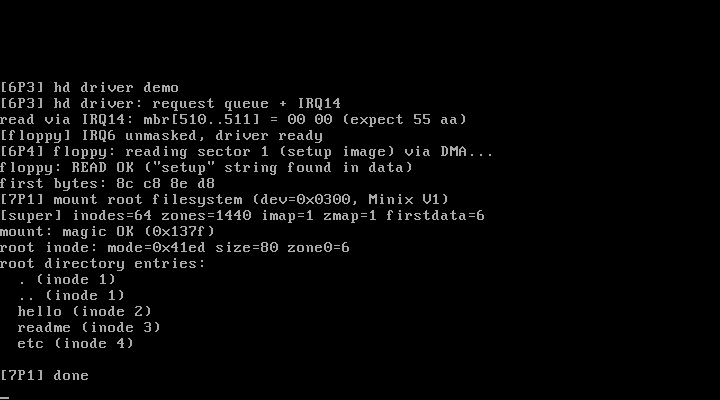

# 7P1 Minix文件系统：超级块 + 挂载 + 根目录

对应书中 **7.1 Minix文件系统**（文件系统的基本结构 / 定义超级块 / 初始化超级块）。
来源：官方仓 `fs/super.c` + `fs/inode.c` 的教学精简版。

## 实验目的

1. **Minix V1 磁盘布局**：引导块(0) → 超级块(1) → inode 位图 → zone 位图
   → inode 表（32B/项，zone 号 16 位）→ 数据区
2. **read_super**：读 1 号块、校验 magic 0x137F、填内核 super_block
3. **iget / bmap**：inode 表定位（块 = 表起始 + (nr-1)/32）、
   文件块号 → 磁盘块号（7 直接块 + 一级间接）
4. **块层适配**：1KB 逻辑块 = 2 个 512B 物理扇区（软盘/硬盘统一入口）

## 配套工具

本仓库顶层新增 `tools/mkfs.py`：纯 Python 的 Minix V1 镜像生成器
（超级块/位图/inode 表/目录树），生成带 hello、readme、etc 的根文件系统。
交叉验证脚本确认了内核读出的布局与镜像内容完全一致。

## 运行效果



```
[7P1] mount root filesystem (dev=0x0300, Minix V1)
[super] inodes=64 zones=1440 imap=1 zmap=1 firstdata=6
mount: magic OK (0x137f)
root inode: mode=0x41ed size=80 zone0=6
root directory entries:
  . (inode 1)
  .. (inode 1)
  hello (inode 2)
  readme (inode 3)
  etc (inode 4)
```

## 运行步骤

```bash
python3 ../../tools/mkfs.py /tmp/minix.img   # 生成根文件系统镜像
make
sh run.sh    # qemu -boot a -fda linux.img -hda /tmp/minix.img
```

## 本实验最重要的坑：栈被 1KB 块写爆

`read_super` 曾用 18 字节的 `struct d_super_block ds` 局部变量接
`blk_read` 的输出——而块层按**整块 1KB** 写！多出的 1006 字节把栈上
的返回地址等全部覆盖，症状是 `printk("[super]...")` 打完、函数
return 时"跳飞"到页目录区执行垃圾。教训：**按块读写的缓冲必须按
BLOCK_SIZE 分配**，磁盘块结构只是缓冲的"视图"（取偏移解读）。

调试手段：qemu 的 unix socket monitor（`-monitor unix:...,server,nowait`）
+ `xp` 物理内存转储 + `info registers`，可以随时抓运行中的内核状态。

## 与官方仓代码的对应关系

| 本实验 | 官方仓 linux_kernel_012 |
| ------ | ----------------------- |
| d_super_block / super_block | `include/linux/fs.h` 同构 |
| read_super | `fs/super.c` 的 read_super（官方还做位图块读入缓存） |
| iget | `fs/inode.c` 的 iget（官方带哈希链与 inode 缓存池，本版单槽） |
| bmap | `fs/inode.c` 的 bmap（官方含创建块/间接块分配，本版只读路径） |
